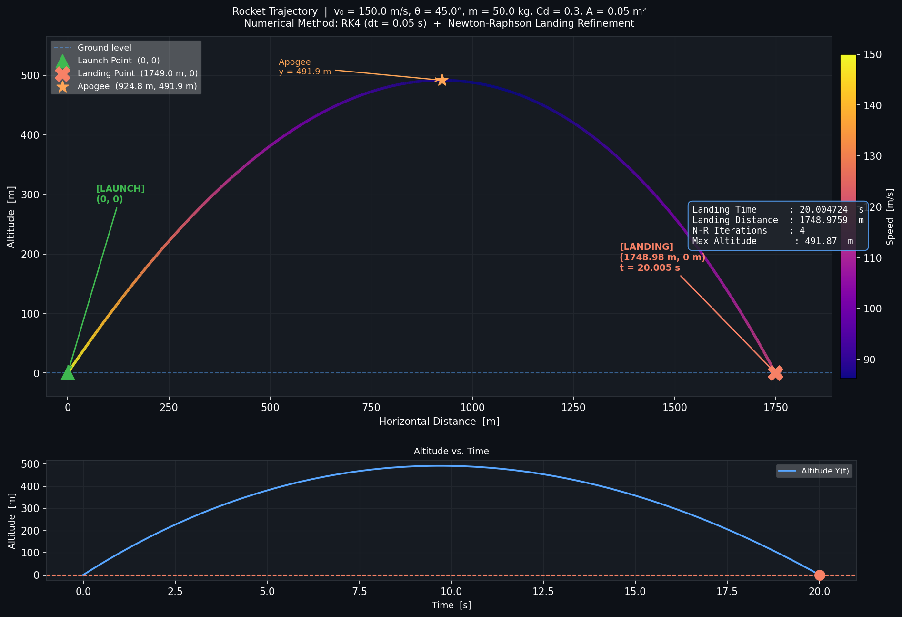

# 🚀 Rocket Trajectory & Landing Prediction Physics Engine

> **Numerical Methods & Analysis — Course Project**  
> Implements **Runge-Kutta 4th Order (RK4)** + **Newton-Raphson root finding** to simulate 2D rocket flight with aerodynamic drag and predict the exact landing point.

---

## Physics Model

**State vector:** `S = [x, y, vx, vy]`

**Air Drag:** `F_drag = 0.5 * ρ * v² * Cd * A`

**Equations of Motion:**
```
dx/dt  =  vx
dy/dt  =  vy
dvx/dt = -(F_drag / m) * cos(θ)
dvy/dt = -g - (F_drag / m) * sin(θ)
```

---

## Numerical Methods

### 1 · Runge-Kutta 4th Order (RK4)
Advances the state vector step-by-step with 4th-order accuracy (global error O(h⁴)).

```
k1 = f(S)
k2 = f(S + h/2 * k1)
k3 = f(S + h/2 * k2)
k4 = f(S + h   * k3)
S_new = S + (h/6)(k1 + 2k2 + 2k3 + k4)
```

### 2 · Newton-Raphson Root Finding
Once RK4 detects ground crossing (Y < 0), Newton-Raphson refines the exact landing time:

```
t_new = t_old - Y(t_old) / Vy(t_old)
```
where `Vy = dY/dt` is used directly as the analytic derivative.

---

## Results (Default Parameters)

| Parameter | Value |
|-----------|-------|
| Initial Speed | 150 m/s |
| Launch Angle | 45° |
| Mass | 50 kg |
| Drag Coefficient Cd | 0.3 |
| **Landing Time** | **20.004724 s** |
| **Landing Distance** | **1748.9759 m** |
| **N-R Iterations** | **4** (converged to \|Y\| = 3.9×10⁻¹⁴ m) |
| Peak Altitude | 491.87 m |

---

## Trajectory Plot



---

## Project Structure

```
rocket_trajectory/
├── rocket_engine.py       # Main simulation (RK4 + Newton-Raphson)
├── rocket_trajectory.png  # Generated trajectory plot
└── README.md
```

### Key Functions

| Function | Purpose |
|----------|---------|
| `aerodynamic_drag()` | Computes F_drag magnitude |
| `odes()` | Returns dS/dt (the ODE right-hand side) |
| `rk4_step()` | Advances state by one time step dt |
| `newton_raphson_landing()` | Finds exact landing time t* |
| `simulate_trajectory()` | Orchestrates the full simulation |
| `plot_trajectory()` | Generates the matplotlib figure |

---

## How to Run

```bash
pip install numpy matplotlib
python rocket_engine.py
```

### Tweak Parameters (top of `rocket_engine.py`)

```python
V0        = 150.0    # m/s  — initial speed
ANGLE_DEG = 45.0     # °    — launch angle
MASS      = 50.0     # kg   — rocket mass
CD        = 0.3      #      — drag coefficient
DT        = 0.05     # s    — RK4 time step
```

> **Tip:** Set `CD = 0` and `RHO = 0` for the ideal no-drag parabola (theoretical range = 2293.6 m), useful as a sanity check.

---

## Dependencies

- Python 3.8+
- `numpy`
- `matplotlib`
